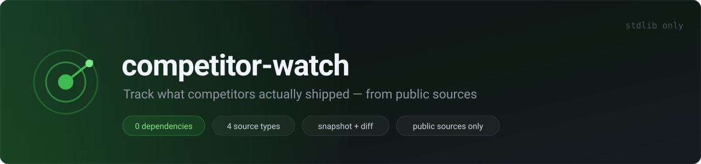
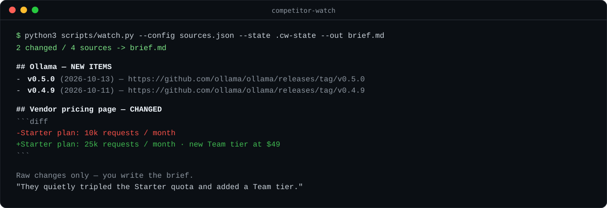

# competitor-watch



[](#tests)
[](#)
[](#)
[](LICENSE)

**An Agent Skill for tracking what your competitors actually shipped — from public sources only.**

Point it at the public pages a company already publishes for humans (release feeds, changelogs, pricing tables, status endpoints). It snapshots them, tells you exactly what changed since last run, and hands you the raw material for a feature brief. No accounts, no API keys, no scraping private app backends — just the standard library and public URLs.

> This is a [Claude / Agent Skill](https://claude.com/docs): a `SKILL.md` file plus helper scripts that an AI agent can load and run. Drop the folder into your skills directory and ask "what has competitor X shipped this week?"



## Why

Competitive research is the same job every week: open 8 tabs, compare against memory, forget half of it. `competitor-watch` makes the deterministic part — fetch, snapshot, diff, cite — a repeatable command, so your attention goes to the only part that needs a brain: deciding what matters.

## Quick start

```bash
# 1. edit the source list
cp examples/sources.example.json my-sources.json

# 2. first run records a baseline
python3 scripts/watch.py --config my-sources.json --state .cw-state --out brief.md

# 3. every run after that reports only what changed
python3 scripts/watch.py --config my-sources.json --state .cw-state --out brief.md
```

Standard library only (Python 3.8+). No `pip install`. Runs in CI, cron, or a scheduled task.

## Source types

| `type`            | Fields                     | Watches |
|-------------------|----------------------------|---------|
| `github_releases` | `repo`                     | Public GitHub releases / tags |
| `rss`             | `url`                      | RSS 2.0 or Atom feed |
| `page`            | `url`                      | Changelog / pricing / docs page (text diff) |
| `json`            | `url`                      | Public no-auth JSON endpoint (key-level diff) |

The report is markdown: per source, a status (`NEW ITEMS` / `CHANGED` / `UNCHANGED` / `ERROR`), the new items with dates and links, and the actual diff for page/JSON sources. The baseline lives in the `--state` file as JSON, so snapshots are reproducible and diffable in git.

## Scopes it on purpose

`competitor-watch` only reads **public, login-free** sources. Reverse-engineering an app's private backend, using a session cookie, or aggregating gated data is out of scope by design — see `SKILL.md` → *Guardrails*.

## Run it on a schedule

The repo ships `.github/workflows/watch.yml`: it runs weekly, snapshots the sources in `sources.json`, and commits the new snapshot + brief back so the next run can diff against it. Edit `sources.json` (or point `--config` at your own file), enable Actions, done.

## Tests

```bash
python3 -m unittest discover -s tests      # zero-dependency
# or:  pytest tests/
```

11 tests covering fetch/fingerprint, HTML text extraction, RSS/JSON sources, the diff state machine (baseline / new items / changed / unchanged), and an end-to-end run. Everything runs offline — sources are local files over `file://` URLs.

## Repo layout

```
SKILL.md                       # the skill: when to use, how, guardrails
scripts/watch.py               # fetch / snapshot / diff engine (stdlib only)
sources.json                   # example source list
examples/sources.example.json  # config with all four source types
references/brief-template.md   # structure for the brief you write afterwards
assets/                        # banner + demo (SVG)
tests/test_watch.py            # unittest suite (offline)
.github/workflows/watch.yml    # weekly scheduled run
```

## 中文简介

`competitor-watch` 是一个 Agent Skill：把竞品**公开发布**的页面（release 订阅、changelog、定价页、公开 JSON 接口）抓下来做快照、对比上一次的变化、生成一份可追溯的技术简报底稿。只用 Python 标准库，零依赖；**只读公开、免登录的源**，不碰任何私有或需要鉴权的接口。把文件夹放进你的 skills 目录，然后问 agent"某竞品这周更新了什么"即可。

## License

MIT
